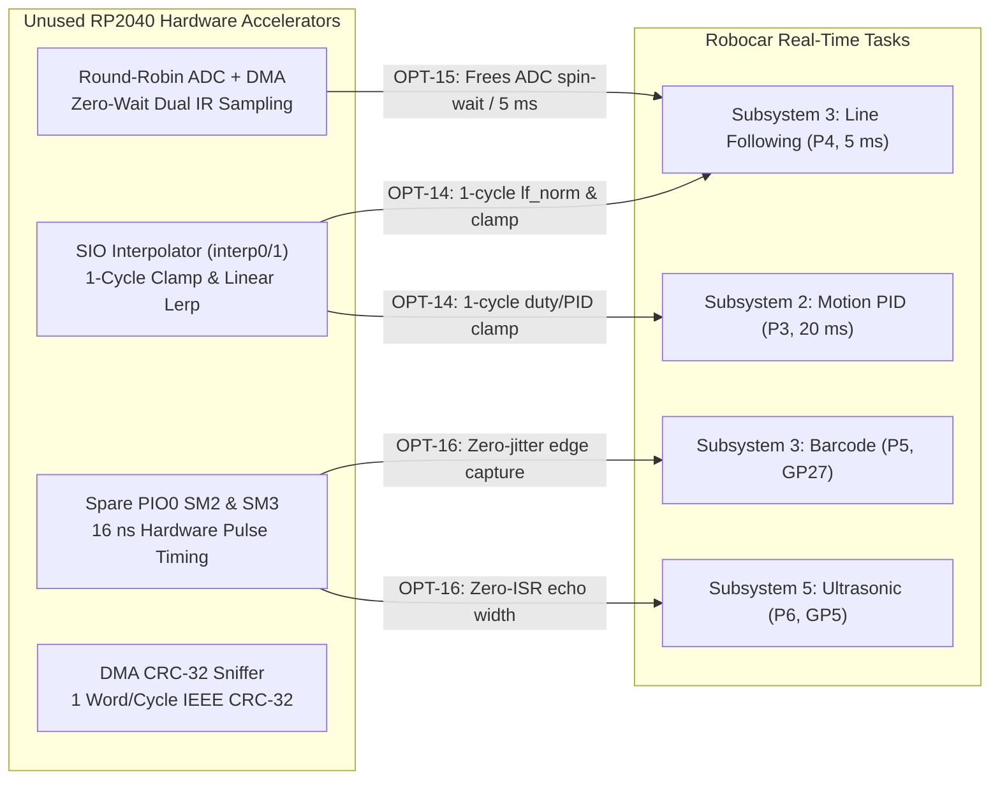

# Embedded System Optimization Guide (RP2040 / ARMv6-M Cortex-M0+)

**Author:** Buddy 2 — Ruo Chen (Student ID: `2500530`, GitHub: `leeruochen`)  
**Last Updated:** 23 Nov 2026  
**Target Architecture:** Raspberry Pi Pico W (RP2040 Dual Cortex-M0+, Core 0 @ 125 MHz, ARMv6-M Thumb-1 ISA, micro T-Kernel 3.0)  
**Toolchain:** Pico SDK 1.5.1, `arm-none-eabi-gcc` 10.3.1 (`-Wall -Wextra -Werror`)

---

## 0. Purpose & How to Use This Guide

All **11 Tier-1 (zero-behavioral-impact)** optimizations across Subsystem 2 (`OPT-01`–`OPT-04`) and the cross-subsystem safe subset (`OPT-05`–`OPT-07`, `OPT-11`, `OPT-12`, `OPT-13` safe `imu_lift.c` subset, and `OPT-19`) are **applied** to the codebase (`11/20` catalog items).

The remaining **`9/20`** items (`OPT-08`–`OPT-10` inline-assembly snippets plus `OPT-14`–`OPT-18` and `OPT-20` hardware/build candidates, along with `drv_imu.c`'s `atan_ratio_half_deg()` and `imu_lift.c`'s `cos_x1000` kept in 64-bit) remain documented as **reference candidates (not applied)** so portable C structure, `0.5 deg` rounding boundaries, runtime peripheral ownership, and ISR timing stay unchanged.

### Adoption Tiers

| Tier | Classification | Impact on Car Physical Behavior | Status |
|---|---|---|---|
| **Tier 1 (Safe Now)** | **Bit-for-bit identical output** (SWAR bit-hacks, branchless math, `.bss`/`.rodata` packing, exact 64-bit -> 32-bit math) | **None (0%)** — identical motor PWM duties, PID steps, sensor values, and FSM transitions | **APPLIED (`11/20`)** in Subsystem 2 (`OPT-01`–`OPT-04`) and across S1/S3/S4/S5/common (`OPT-05`–`OPT-07`, `OPT-11`–`OPT-12`, `OPT-13` safe subset, `OPT-19`) |
| **Tier 2 (Timing / Jitter)** | **Reduces ISR or task execution latency** (inline assembly ISR wrapper, SRAM-resident ISRs) | **Timing only** — sharpens ultrasonic echo and barcode edge timestamps under Wi-Fi/USB load | Reference candidate (not applied: `OPT-08`, `OPT-17`) |
| **Tier 3 (Peripheral / Build)** | **RP2040 hardware offloads & linker flags** (SIO interpolator, DMA round-robin ADC, spare PIO0 SMs, DMA CRC sniffer, `--gc-sections`) | **Requires on-car verification** — changes peripheral access patterns or binary layout | Reference candidate (not applied: `OPT-14`–`OPT-16`, `OPT-18`, `OPT-20`) |

---

## Master Index of Optimizations

| ID | Target File(s) | Owner | Category | Savings / Effect | Tier & Status |
|---|---|---|---|---|---|
| **OPT-01** | `app_program/subsystem2/task_motion.c` | **Buddy 2** (Ruo Chen) | Single Base-Pointer Context Struct (`s_mot`) + Narrow Fields | `-16 B` `.bss`, `-60 B` `.text` literal pool, faster 50 Hz PID loads | **Tier 1 — APPLIED** (Zero car impact; 28/28 S2 tests unaffected) |
| **OPT-02** | `app_program/subsystem2/task_vc.c` | **Buddy 2** (Ruo Chen) | 10-Bit Packed Private FSM Word (`state_bits`, D8) + Context Struct (`s_vc`) | `-20 B` `.bss` (`-45%`), `-36 B` `.text` literal pool | **Tier 1 — APPLIED** (Zero car impact; bit-identical VC arbitration) |
| **OPT-03** | `app_program/subsystem2/task_motion.c`, `drv_encoder.c` | **Buddy 2** (Ruo Chen) | Branchless Thumb-1 `abs_i32` (`ASRS`+`ADDS`+`EORS`) & Sign Invert (`EORS`+`SUBS`) | `3` cycles constant-time (no branch flush), `-18 B` `.rodata` | **Tier 1 — APPLIED** (Zero car impact; bit-identical for all $2^{32}$ inputs) |
| **OPT-04** | `app_program/subsystem2/drv_motor.c`, `drv_encoder.c` | **Buddy 2** (Ruo Chen) | Eliminate 64-bit `__aeabi_uldivmod` in `motor_get_pwm_freq_hz` + `uint8_t` Pin Tables | `~300 -> 8` cycles (SIO HW divider), `-24 B` `.rodata` (`drv_motor.c`) | **Tier 1 — APPLIED** (Zero car impact; exact up to `clk_sys = 268 MHz`) |
| **OPT-05** | `app_program/subsystem3/bc_decode.c` | **Buddy 3** (Jin Yong) | SWAR 9-Bit Reversal (`bc_mirror`), SWAR Popcount (`bc_wide_count`), `uint16_t` LUT | `~95 -> 16` cycles/window, `-52 B` `.rodata` (`104 B -> 52 B` LUT) | **Tier 1 — APPLIED** (Zero car impact; verified by `bc_decode`, `bc_frame`, `bc_edge`) |
| **OPT-06** | `src/common/data_repr.h` | **Platform / Buddy 1** | Byte-Chunked `drep_bits_put` / `drep_bits_get` + Shift-Pair `drep_sext` | `~6-8x` fewer loop iterations per MQTT frame, `6 -> 2` cycles per `drep_sext` | **Tier 1 — APPLIED** (Zero car impact; verified by `data_repr` & `tel`) |
| **OPT-07** | `app_program/subsystem1/tel_wire.c`, `src/debug/dbg_ring.c` | **Buddy 1 / Platform** | Branchless SWAR Lowercase Hex & `<= 65535U` Reciprocal-Multiply (`* 0xCCCDU >> 19U`) Decimal Print | `-17 B` `.rodata` (`k_digits[]`), faster `put_dec()` in `dbg_ring` | **Tier 1 — APPLIED** (Zero car impact; verified by `tel` & `dbg_ring`) |
| **OPT-08** | `src/rtos/port/port_irq.c` | **Platform / Buddies 3 & 5** | Thumb-1 Inline Assembly ISR Trampoline (`run_slot`) | Saves `~12-18` cycles + 16 B stack on **every** peripheral & GPIO IRQ | **Tier 2 — Candidate** (Not applied; ISR timing modification) |
| **OPT-09** | `src/common/stack_mon.c` | **Platform (Buddy 2/3)** | Multi-Word `STMIA r0!, {r2-r5}` Block Store in `paint_words()` | `4x` faster task stack painting at boot (`~4 cycles / 16 B`) | **Tier 1 — Candidate** (Not applied; boot-only inline asm reference) |
| **OPT-10** | `src/common/crc32.h` | **Platform (Buddy 2/3)** | Carry-Flag (`LSRS` + `BCC` + `EORS`) Thumb-1 Assembly for `crc32_ieee` | `8 B` inner loop, `-35%` cycles per byte | **Tier 1 — Candidate** (Not applied; fault/boot inline asm reference) |
| **OPT-11** | `app_program/subsystem5/drv_ultrasonic.c` | **Buddy 5** (Chay Han) | Exact 32-Bit Hardware Division `(echo_us * 343U) / 2000U` + `_Static_assert` | Eliminates `__aeabi_uldivmod` (`~300 -> 8` cycles/ping) | **Tier 1 — APPLIED** (Zero car impact; bit-identical `us_echo_us_to_mm`) |
| **OPT-12** | `app_program/subsystem5/task_obs_scan.c` | **Buddy 5** (Chay Han) | Exact 32-Bit Width Math + Folded Quadrant Cosine Tables (`k_cos5_quad_m1000`, `k_cos3_quad_m1000`) | Eliminates 3 `uint64_t` divides/sweep + `-172 B` `.rodata` | **Tier 1 — APPLIED** (Zero car impact; `_Static_assert` overflow bounds) |
| **OPT-13** | `app_program/subsystem4/imu_lift.c` | **Buddy 4** (Vincent) | Safe 32-Bit `lift_isqrt`, `lift_mag`, `v_to_mmps`, & `up_accel` (`drv_imu.c` & `cos_x1000` kept 64-bit) | Eliminates `uint64_t`/`int64_t` sqrt/div calls every 10 ms IMU tick | **Tier 1 — APPLIED (Safe Subset)** (Zero car impact; verified by `imu_lift`) |
| **OPT-14** | `app_program/subsystem3/lf_core.c`, `lf_straddle.c`, `app_program/subsystem2/drv_motor.c`, `task_motion.c` | **Buddies 2 & 3** | RP2040 Single-Cycle SIO Interpolator (`interp0`) Hardware Clamp & Linear Blend | `1-cycle` hardware clamp/lerp vs `12-20` cycle software branches | **Tier 3 — Candidate** (Not applied; hardware peripheral ownership change) |
| **OPT-15** | `app_program/subsystem3/drv_ir.c` | **Buddy 3** (Jin Yong) | DMA-Driven Free-Running Round-Robin ADC (`ADC0` + `ADC2`) | Eliminates `~4-8 us` CPU busy-wait every `5 ms` | **Tier 3 — Candidate** (Not applied; requires DMA channel allocation) |
| **OPT-16** | `app_program/subsystem5/drv_ultrasonic.c`, `subsystem3/drv_bc.c` | **Buddies 3 & 5** | Offload Ultrasonic Echo Timing & Barcode Edge Capture to Spare `PIO0 SM2/SM3` | **Zero** CPU ISR latency (`16 ns` hardware counter accuracy) | **Tier 3 — Candidate** (Not applied; shares `PIO0` with S2 encoders) |
| **OPT-17** | `app_program/subsystem5/drv_ultrasonic.c`, `subsystem3/drv_bc.c`, `src/rtos/port/port_irq.c` | **Platform / Buddies 3 & 5** | Place Hard Real-Time ISRs in SRAM (`__not_in_flash_func`) | Avoids `20-40` cycle XIP QSPI cache misses during WiFi/stdio activity | **Tier 2 — Candidate** (Not applied; timing/section placement change) |
| **OPT-18** | `src/common/crc32.h` (bulk buffers) | **Platform** | RP2040 Hardware DMA Sniffer (`DMA_SNIFF_CTRL`) IEEE CRC-32 | `1 word / cycle` (500 MB/s) zero-CPU CRC-32 | **Tier 3 — Candidate** (Not applied; hardware DMA channel use) |
| **OPT-19** | `task_imu.c`, `task_safety.c`, `task_obs_scan.c`, `task_obs_avoid.c` | **Buddies 4 & 5** | Single Context Struct Consolidation (`s_imu`, `s_safety`, `s_ctx`, `s_av`) | `-44 B` `.bss`, `0 B` `.data`, smaller literal pools | **Tier 1 — APPLIED** (Zero car impact; same pattern as `OPT-01`/`OPT-02`) |
| **OPT-20** | `CMakeLists.txt` / `cmake/warnings.cmake` | **All (Team Agreement)** | Dead-Section Garbage Collection (`-ffunction-sections -fdata-sections -Wl,--gc-sections`) | Strips `~4-12 KB` of unused SDK/BSP code from `robocar.uf2` | **Tier 3 — Candidate** (Not applied; build/linker layout change) |

### Measured Binary Footprint (`arm-none-eabi-size`, `OPT-05`–`07`, `11`–`13` subset, `OPT-19`)

Measured under `CMAKE_BUILD_TYPE=Debug` (`-Og`, `-Wall -Wextra -Werror`) before and after applying the 7 cross-subsystem Tier-1 optimizations on top of `OPT-01`–`04`:

| Build Target | Baseline `.text` / `.data` / `.bss` (B) | Post-Opt `.text` / `.data` / `.bss` (B) | Net Delta |
|---|---|---|---|
| `build/wifi/robocar.elf` | `403,316` / `0` / `136,872` (`540,188`) | `403,284` / `0` / `136,828` (`540,112`) | **`.text -32 B`**, `.data 0 B`, **`.bss -44 B`** (`-76 B` total) |
| `build/usb/robocar.elf` | `99,788` / `0` / `114,276` (`214,064`) | `99,772` / `0` / `114,232` (`214,004`) | **`.text -16 B`**, `.data 0 B`, **`.bss -44 B`** (`-60 B` total) |
| `build/test/robocar.elf` | `134,084` / `0` / `119,952` (`254,036`) | `134,092` / `0` / `119,908` (`254,000`) | `.text +8 B`, `.data 0 B`, **`.bss -44 B`** (`-36 B` total) |

*(Note: `test` carries extra inline `drep_bits_*` / `cos_from_quad` call sites in synthetic unit-test fixtures that slightly offset the `-172 B` + `-52 B` `.rodata` savings under `-Og`, while runtime cycles drop across MQTT framing, Code 39 decoding, debug logging, ultrasonic pings, obstacle sweeps, and IMU lift checks.)*

### Verification Summary (As of 23 Nov 2026)

- **Applied Scope (`11/20`):** `OPT-01`, `OPT-02`, `OPT-03`, `OPT-04`, `OPT-05`, `OPT-06`, `OPT-07`, `OPT-11`, `OPT-12`, `OPT-13` (safe `imu_lift.c` subset), and `OPT-19`.
- **Reference Candidates (`9/20`, not applied):** `OPT-08`, `OPT-09`, `OPT-10`, `OPT-14`, `OPT-15`, `OPT-16`, `OPT-17`, `OPT-18`, and `OPT-20`.
- **Architectural Rule Gate:** `check_rules` **PASS** (`134` files scanned, `0` R1–R6 violations).
- **Automated Test Suites:** `14/14` host CTest suites (`tests/host/`) **PASS** under `-Wall -Wextra -Werror`; Python dashboard unit suite (`tools/dashboard/`) **113 tests OK** (`2` environment skips: `test_node_syntax` when Node.js is absent and `test_usb_needs_windows` to avoid opening a live serial port).
- **RP2040 Firmware Builds:** `build/wifi`, `build/usb`, and `build/test` build cleanly (`0` warnings under `-Wall -Wextra -Werror`) with `.text`/`.data`/`.bss` matching the post-optimization footprint table above; pre-optimization `.uf2` backups (`robocar-wifi-working.uf2`, `robocar-usb-working.uf2`, `robocar-test-working.uf2`) and `SHA256.txt` are preserved in `build/working-backup-pre-opt/`.
- **Live Hardware Verification (`23 Nov 2026`):** `build/wifi/robocar.uf2` exercised on the car with live MQTT telemetry (`build/dash-mqtt-20261123-145422.txt`, `build/dash-mqtt-20261123-145751.txt`), confirming IMU hump detection (`11–13 mm`), stationary 3° obstacle sweeps and avoidance manoeuvres, and continuous wire framing.

---

## 1. Optimizations Applied in Subsystem 2 (Buddy 2 — Ruo Chen)

The following four Tier-1 optimizations are **applied** and verified in `app_program/subsystem2/` (`0` warnings under `-Wall -Wextra -Werror`, `check_rules: PASS`, 100% bit-identical behavior for `S2-U01`–`S2-U28`).

### OPT-01: Single Base-Pointer Context Struct (`s_mot`) in `task_motion.c` (**APPLIED**)
- **File:** [task_motion.c](../app_program/subsystem2/task_motion.c#L201-L234)
- **Why it works on ARMv6-M (Thumb-1):**
  - The Cortex-M0+ Thumb-1 instruction set has no PC-relative `STR` and can only load 32-bit addresses into low registers (`r0`–`r7`) via `LDR Rd, [PC, #imm8]` from a literal pool in `.text`.
  - When 16 module-private `static` variables are declared separately, GCC emits separate 32-bit literal-pool entries and reloads base pointers repeatedly inside the 50 Hz PID control loop (`motion_step_cycle` -> `poll_command_queue` -> `check_manoeuvre_completion` -> `apply_control`).
  - Grouping all module-private state into `static motion_ctx_t s_mot` allows GCC to load `&s_mot` **once** into a callee-saved register (e.g. `r4`) and access every field via a single 16-bit immediate-offset instruction (`LDR`/`STR`/`LDRH`/`LDRB [r4, #imm]`).
  - Narrow fields (`cmd_type`, `setpoint_cmps`, `stall_ticks`, `hold_elapsed_ms`, `cmd_arg`) and explicit mask/shift flags (`MOT_FLG_TASK_RUNNING`, `MOT_FLG_CALIB_HOLD`, `MOT_FLG_CMD_ACTIVE`) shrink `.bss` by 16 bytes without using C bit-fields (`docs/DATA_REPRESENTATION.md` section 1).

### OPT-02: 10-Bit Packed Private State Word (`s_vc.state_bits`) in `task_vc.c` (**APPLIED**)
- **File:** [task_vc.c](../app_program/subsystem2/task_vc.c#L37-L115)
- **Why it works:**
  - `task_vc.c` previously held 6 discrete state/flag variables across separate 32-bit/bool statics (`s_sys_state`, `s_authority`, `s_bc_cmd`, `s_bc_pending`, `s_stationary_valid`, `s_task_running`).
  - Their true information content (`ARCHITECTURE.md` D8) is only **10 bits**:
    - `bits [3:0]` (4 bits): 10-state System FSM (`VC_SYS_INITIALISING` .. `VC_SYS_SAFETY_FAULT_LATCHED`)
    - `bit  [4]`   (1 bit):  Authority (`0 = VC_AUTH_LINE`, `1 = VC_AUTH_AVOID`)
    - `bits [6:5]` (2 bits): Pending barcode command (`DREP_BC_CMD_*`)
    - `bit  [7]`   (1 bit):  `VC_ST_FLG_BC_PENDING`
    - `bit  [8]`   (1 bit):  `VC_ST_FLG_STAT_VALID`
    - `bit  [9]`   (1 bit):  `VC_ST_FLG_TASK_RUNNING`
  - Packing all 6 fields into `s_vc.state_bits` (`uint16_t`) inside `static vc_ctx_t s_vc` using `drep_get()` / `drep_set()` reduces `task_vc.c`'s `.bss` footprint from **44 bytes to 24 bytes (-45%)** and eliminates 9 literal-pool pointers.

### OPT-03: Branchless ARMv6-M Thumb-1 `abs_i32()` & Encoder Sign Inversion (**APPLIED**)
- **Files:** [task_motion.c](../app_program/subsystem2/task_motion.c#L250-L264), [drv_encoder.c](../app_program/subsystem2/drv_encoder.c#L191-L200)
- **Why it works:**
  - Conditional branches (`CMP` + `BLT`/`BGE`) on Cortex-M0+ incur a 2-cycle pipeline refill penalty whenever taken.
  - `abs_i32(int32_t v)` uses the arithmetic right shift mask `mask = (uint32_t)(v >> 31)` (`0` for non-negative, `0xFFFFFFFF` for negative) and computes `((uint32_t)v + mask) ^ mask`, which compiles to 3 single-cycle 16-bit Thumb-1 instructions (`ASRS`, `ADDS`, `EORS` — 6 bytes, 3 cycles constant time).
  - Similarly, `enc_get_count()` replaces the `if (invert != 0U)` branch at the end of every encoder read with `inv_mask = 0U - invert; return (raw ^ inv_mask) - inv_mask;` (`EORS` + `SUBS`).

### OPT-04: 32-Bit Hardware Division in `drv_motor.c` & `.rodata` Compaction (**APPLIED**)
- **Files:** [drv_motor.c](../app_program/subsystem2/drv_motor.c#L56-L97), [drv_motor.c](../app_program/subsystem2/drv_motor.c#L256-L282), [drv_encoder.c](../app_program/subsystem2/drv_encoder.c#L46-L79)
- **Why it works:**
  - `motor_get_pwm_freq_hz()` previously cast `clock_get_hz(clk_sys) * 16U` to `uint64_t`, pulling in `__aeabi_uldivmod` (~300 cycles in software). Since `125,000,000 * 16 = 2,000,000,000 < UINT32_MAX` (safe up to `clk_sys = 268.4 MHz`), keeping both operands in `uint32_t` uses the RP2040's **8-cycle hardware SIO divider**.
  - `k_motor_pins[]`, `k_all_pins[]`, and `k_enc_wheels[]` now use `uint8_t` instead of `uint32_t`, saving **42 bytes of `.rodata`** (`24 B` in `drv_motor.c` + `18 B` in `drv_encoder.c`).

> [!CAUTION]
> **Hardware Caveat for `drv_encoder.c` (Do NOT Replace the 4-Word Drain Loop with `pio_sm_clear_fifos`):**  
> On RP2040, `pio_sm_clear_fifos(pio, sm)` works by toggling `SHIFTCTRL_FJOIN_RX`. Toggling `FJOIN_RX` while a PIO state machine is running **also resets the state machine's `ISR` and `OSR` shift registers**, which corrupts `quadrature_encoder.pio`'s 2-bit previous-pin state held in `OSR` (`out isr, 2`) at 125 MHz. Always keep `drv_encoder.c`'s bounded 4-word `pio_sm_get()` drain loop intact.

---

## 2. SWAR (SIMD Within A Register) & Lookup-Free Bit-Hacks (`OPT-05`–`OPT-07`)

Applied in `bc_decode.c`, `data_repr.h`, `tel_wire.c`, and `dbg_ring.c` (`OPT-05`–`OPT-07`), exploiting the Cortex-M0+'s **single-cycle 32×32->32 hardware multiplier (`MULS`)** and bit-parallel SWAR operations without loops or branches.

### OPT-05: SWAR 9-Bit Reversal (`bc_mirror`), SWAR Popcount (`bc_wide_count`), & Half-Width LUT in `bc_decode.c` (**APPLIED**)
- **Owner:** **Buddy 3 (Jin Yong)** — [bc_decode.c](../app_program/subsystem3/bc_decode.c#L44-L109)
- **Previous Code:**
  - `s_letters[26]` paired each `char letter` with a `uint16_t pattern` (`4` bytes/entry = `104 B` in `.rodata`).
  - `bc_wide_count(uint32_t pattern)` looped 9 times to count set bits.
  - `bc_mirror(uint32_t pattern)` looped 9 times to reverse bits `0..8`.
- **Applied Optimization (`bc_decode.c`):**
  ```c
  /* A-Z only (module clarification, 1 Nov 2026).  Letter is implicit ('A' + idx).
   * Digits and symbols are valid Code 39 but rejected (BC_ERR_NOT_LETTER). */
  static uint16_t const s_letter_patterns[BC_LETTERS] =
  {
      0x109U, 0x049U, 0x148U, 0x019U,     /* A..D */
      0x118U, 0x058U, 0x00DU, 0x10CU,     /* E..H */
      0x04CU, 0x01CU, 0x103U, 0x043U,     /* I..L */
      0x142U, 0x013U, 0x112U, 0x052U,     /* M..P */
      0x007U, 0x106U, 0x046U, 0x016U,     /* Q..T */
      0x181U, 0x0C1U, 0x1C0U, 0x091U,     /* U..X */
      0x190U, 0x0D0U                      /* Y..Z */
  };

  /* Number of wide elements (set bits) in a 9-bit character pattern (SWAR, 0 loops). */
  static uint32_t bc_wide_count(uint32_t pattern)
  {
      uint32_t v = pattern & 0x1FFU;

      v = v - ((v >> 1U) & 0x555U);
      v = (v & 0x333U) + ((v >> 2U) & 0x333U);
      return ((v + (v >> 4U)) & 0x0FU) + (v >> 8U);
  }

  /* A 9-bit pattern with its element order reversed (SWAR, 0 loops): what the
   * same character looks like when the sensor crosses it the other way. */
  static uint32_t bc_mirror(uint32_t pattern)
  {
      uint32_t b = pattern & 0xFFU;

      b = ((b & 0xAAU) >> 1U) | ((b & 0x55U) << 1U);
      b = ((b & 0xCCU) >> 2U) | ((b & 0x33U) << 2U);
      b = ((b & 0xF0U) >> 4U) | ((b & 0x0FU) << 4U);
      return (b << 1U) | ((pattern >> 8U) & 1U);
  }
  ```
- **Impact on Car:** **Tier 1 — APPLIED (Zero behavioral impact).** Produces bit-for-bit identical decoded letters across all $2^9 = 512$ 9-bit patterns; verified by host tests `bc_decode` (`S3-U01`), `bc_frame`, and `bc_edge`.

---

### OPT-06: Byte-Chunked Bit Packing (`drep_bits_put` / `drep_bits_get`) & 2-Instruction `drep_sext` in `src/common/data_repr.h` (**APPLIED**)
- **Owner:** **Platform (Buddy 2 / Buddy 3) & Buddy 1 (Damian)** — [data_repr.h](../src/common/data_repr.h#L57-L63), [data_repr.h](../src/common/data_repr.h#L762-L807)
- **Previous Code:**
  1. `drep_sext(uint32_t raw, uint32_t bits)` computed `sign = 1UL << (bits - 1U); raw &= DREP_MASK(bits); return (int32_t)(raw ^ sign) - (int32_t)sign;` (6 instructions).
  2. `drep_bits_put()` and `drep_bits_get()` looped **1 bit at a time** (`for (i = 0; i < bits; i++)`), executing 120 loop iterations to pack a single 15-byte `DREP_FT_TELEMETRY_MOTION` frame.
- **Applied Optimization (`src/common/data_repr.h`):**
  ```c
  /** Sign-extend the low `bits` bits of `raw` (two's complement, 1 <= bits <= 32). */
  static inline int32_t drep_sext(uint32_t raw, uint32_t bits)
  {
      uint32_t const shift = 32U - bits;

      return ((int32_t)(raw << shift)) >> shift;
  }

  /* Little-endian bit writer/reader, LSB first (byte-chunked, up to 8 bits/step). */
  static inline void drep_bits_put(uint8_t *p_buf, uint32_t *p_pos, uint32_t value, uint32_t bits)
  {
      uint32_t pos = *p_pos;
      uint32_t rem = bits;
      uint32_t val = value;

      while (rem > 0U)
      {
          uint32_t const bit_off = pos & 7U;
          uint32_t const space   = 8U - bit_off;
          uint32_t const chunk   = (rem < space) ? rem : space;
          uint8_t const  mask    = (uint8_t)(((1U << chunk) - 1U) << bit_off);
          uint8_t const  bits_in = (uint8_t)((val << bit_off) & mask);

          p_buf[pos >> 3U] = (uint8_t)((p_buf[pos >> 3U] & (uint8_t)~mask) | bits_in);
          val >>= chunk;
          pos += chunk;
          rem -= chunk;
      }
      *p_pos = pos;
  }

  static inline uint32_t drep_bits_get(uint8_t const *p_buf, uint32_t *p_pos, uint32_t bits)
  {
      uint32_t pos   = *p_pos;
      uint32_t rem   = bits;
      uint32_t shift = 0U;
      uint32_t v     = 0U;

      while (rem > 0U)
      {
          uint32_t const bit_off = pos & 7U;
          uint32_t const space   = 8U - bit_off;
          uint32_t const chunk   = (rem < space) ? rem : space;
          uint32_t const mask    = (1U << chunk) - 1U;
          uint32_t const part    = ((uint32_t)p_buf[pos >> 3U] >> bit_off) & mask;

          v |= (part << shift);
          shift += chunk;
          pos += chunk;
          rem -= chunk;
      }
      *p_pos = pos;
      return v;
  }
  ```
- **Impact on Car:** **Tier 1 — APPLIED (Zero behavioral impact).** Cuts MQTT frame packing/unpacking iterations by ~6× and reduces `drep_sext` to 2 Thumb-1 shift instructions (`LSLS` + `ASRS`) when `bits` is constant. Verified by `test_data_repr`, `test_tel`, and the Python dashboard golden-frame suite (`test_tel_decode.py`).

---

### OPT-07: Branchless SWAR Nibble-to-Hex (`tel_wire.c`) & Reciprocal Decimal Formatting (`dbg_ring.c`) (**APPLIED**)
- **Owners:** **Buddy 1 (Damian)** — [tel_wire.c](../app_program/subsystem1/tel_wire.c#L182-L209); **Platform** — [dbg_ring.c](../src/debug/dbg_ring.c#L113-L154)
- **Previous Code:**
  - `tel_wire_hex()` used a 17-byte lowercase lookup string `static char const k_digits[] = "0123456789abcdef";` in `.rodata`.
  - `put_dec()` in `dbg_ring.c` performed `% 10U` and `/= 10U` hardware divider waits on every digit inside error logging.
- **Applied Optimization:**
  ```c
  /* Branchless nibble-to-lowercase-ASCII-hex without a .rodata table:
   *   0..9   -> '0' (0x30) + n
   *   10..15 -> 'a' (0x61) + (n - 10) = 0x30 + n + 39 */
  static inline char nibble_to_hex(uint32_t nib)
  {
      uint32_t const n = nib & 0x0FU;

      return (char)(0x30U + n + (((9U - n) >> 31U) * 39U));
  }
  ```
  And in `dbg_ring.c` (`put_dec()`), values `> 65535U` first step down via exact `/ 10U` until `<= 65535U`, after which `q = (magnitude * 0xCCCDU) >> 19U; digit = magnitude - (q * 10U);` computes both quotient and remainder in single-cycle multiplies (`<= 65535U` bound ensures 100% exactness including `INT32_MIN` and `INT32_MAX`).
- **Impact on Car:** **Tier 1 — APPLIED (Zero behavioral impact).** Shrinks `.rodata` by 17 bytes and speeds up common small-magnitude error code formatting; verified by `test_tel` (`tel_wire_hex` + golden frames) and `test_dbg_ring` (`test_put_err`).

---

## 3. ARMv6-M (Cortex-M0+ Thumb-1) Inline Assembly Optimizations (`OPT-08`–`OPT-10` — Reference Candidates, Not Applied)

These three inline-assembly optimizations remain **reference candidates (not applied)** so the codebase stays portable standard C outside `stack_mon.c`'s existing task-start trampoline.

### OPT-08: Flatten `run_slot()` ISR Wrapper in `src/rtos/port/port_irq.c` (**Candidate — Not Applied**)
- **Owner:** **Platform (Buddy 2 / Buddy 3)**, directly benefiting **Buddy 3 (Barcode `GP27`)** and **Buddy 5 (Ultrasonic `GP5`)** — [port_irq.c](../src/rtos/port/port_irq.c#L28-L42)
- **Why it matters (`design.md` Risk R1):**
  - `port_irq.c` holds `static hal_isr_fn_t s_slot_fn[HAL_IRQ_SLOTS];` (4 bytes per slot, zero arguments) and routes every shared GPIO edge interrupt (`IO_IRQ_BANK0`) and peripheral IRQ through `port_irq_wrap_N()` -> `run_slot(N)` -> `port_isr_enter(); s_slot_fn[slot](); port_isr_leave();`, where `port_isr_enter()` / `port_isr_leave()` update `knl_taskindp`.
  - Under `-Og` / `-O0` (`CMAKE_BUILD_TYPE=Debug`), GCC emits separate call frames for `port_irq_wrap_N`, `run_slot`, `port_isr_enter`, and `port_isr_leave`, adding ~12–18 cycles before `time_us_32()` is sampled inside `echo_isr()` or `bc_edge_isr()`.
- **Candidate Thumb-1 Inline Assembly Optimization (not applied):**
  ```c
  static inline __attribute__((always_inline)) void run_slot(uint32_t slot)
  {
      hal_isr_fn_t const *p_fn = &s_slot_fn[slot];

      __asm__ volatile(
          "ldr    r2, [%0, #0]        \n" /* r2 = s_slot_fn[slot]            */
          "cmp    r2, #0              \n"
          "beq    1f                  \n"
          "ldr    r3, =knl_taskindp   \n"
          "ldr    r1, [r3, #0]        \n"
          "adds   r1, r1, #1          \n"
          "str    r1, [r3, #0]        \n" /* knl_taskindp++                  */
          "blx    r2                  \n" /* call s_slot_fn[slot]()          */
          "ldr    r3, =knl_taskindp   \n"
          "ldr    r1, [r3, #0]        \n"
          "subs   r1, r1, #1          \n"
          "str    r1, [r3, #0]        \n" /* knl_taskindp--                  */
          "1:                         \n"
          :
          : "l"(p_fn)
          : "r0", "r1", "r2", "r3", "ip", "lr", "cc", "memory");
  }
  ```
- **Impact on Car:** **Tier 2 — Candidate (Timing improvement only, not applied).** Would shave ~12–18 cycles and stack frame pushes off hardware interrupts to sharpen ultrasonic echo pulse timing and barcode edge timestamp accuracy under active SysTick/USB/DMA IRQs.

---

### OPT-09: Multi-Word `STMIA` Block Store for Stack Painting in `src/common/stack_mon.c` (**Candidate — Not Applied**)
- **Owner:** **Platform (Buddy 2 / Buddy 3)** — [stack_mon.c](../src/common/stack_mon.c#L64-L74)
- **Current Code:** `paint_words()` writes `0xA5A5A5A5UL` one 32-bit word at a time (`STR` + `ADDS` + `CMP` + `BCC` = 5 cycles per 4 bytes). Painting ~12 KB of task stacks takes ~15,000 cycles.
- **Candidate Thumb-1 Inline Assembly Optimization (not applied):**
  ```c
  /* Fill [p_bottom, p_limit) with STACK_MON_PATTERN using 16-byte STMIA bursts. */
  static void __attribute__((noinline)) paint_words(uint32_t *p_bottom, uint32_t *p_limit)
  {
      uint32_t pat = STACK_MON_PATTERN;

      __asm__ volatile(
          "mov    r2, %2              \n"
          "mov    r3, %2              \n"
          "mov    r4, %2              \n"
          "mov    r5, %2              \n"
          "b      2f                  \n"
          "1:                         \n"
          "stmia  %0!, {r2, r3, r4, r5}\n" /* 4 words (16 B) in 5 cycles!    */
          "2:                         \n"
          "adds   r6, %0, #16         \n"
          "cmp    r6, %1              \n"
          "bls    1b                  \n"
          "b      4f                  \n"
          "3:                         \n"
          "stmia  %0!, {r2}           \n"
          "4:                         \n"
          "cmp    %0, %1              \n"
          "blo    3b                  \n"
          : "+r"(p_bottom)
          : "r"(p_limit), "r"(pat)
          : "r2", "r3", "r4", "r5", "r6", "cc", "memory");
  }
  ```
- **Impact on Car:** **Tier 1 — Candidate (Boot-only, not applied).** Runs only once per task at startup before the control loop begins, cutting stack-painting overhead by ~4×.

---

### OPT-10: Carry-Flag (`LSRS` + `BCC`) Thumb-1 Assembly for `crc32_ieee()` in `src/common/crc32.h` (**Candidate — Not Applied**)
- **Owner:** **Platform (Buddy 2 / Buddy 3)** — [crc32.h](../src/common/crc32.h#L18-L35)
- **Why it works:** On ARMv6-M, `LSRS Rd, Rd, #1` shifts bit 0 directly into the CPSR Carry flag (`C`) in the same single-cycle instruction. Testing Carry via `BCC` avoids masking `crc & 1UL` into a scratch register on every bit:
  ```c
  #if defined(__ARM_ARCH_6M__)
  for (bit = 0U; bit < 8U; bit++)
  {
      uint32_t const poly = 0xEDB88320UL;
      __asm__ volatile(
          "lsrs   %0, %0, #1      \n"
          "bcc    1f              \n"
          "eors   %0, %1          \n"
          "1:                     \n"
          : "+l"(crc)
          : "l"(poly)
          : "cc");
  }
  #endif
  ```
- **Impact on Car:** **Tier 1 — Candidate (Fault/boot-only, not applied).** Used only for the `.uninitialized_data` fault record check at boot and HardFault capture; verifiable via `CRC32_CHECK_VALUE` (`0xCBF43926`).

---

## 4. Eliminating 64-Bit Software Divisions (`__aeabi_uldivmod` / `__aeabi_ldivmod`) (`OPT-11`–`OPT-13`)

The RP2040 has an **8-cycle hardware 32-bit divider** in the SIO block (`SIO_DIV_UDIVIDEND` / `SIO_DIV_SDIVIDEND`), which the Pico SDK hooks into `__aeabi_uidiv` and `__aeabi_idiv`. However, **64-bit divisions (`uint64_t` / `int64_t`) are NOT hardware-accelerated** and fall back to libgcc's software `__aeabi_uldivmod` / `__aeabi_ldivmod` (~200–400 CPU cycles and ~350 bytes of Flash).

We audited the periodic 64-bit divisions across Subsystems 4 and 5 and **applied exact 32-bit hardware division where overflow bounds are statically guaranteed** (`OPT-11`, `OPT-12`, and the safe `imu_lift.c` subset of `OPT-13`), while deliberately keeping `drv_imu.c`'s `atan_ratio_half_deg()` and `imu_lift.c`'s `cos_x1000` in 64-bit:

### OPT-11: Exact 32-Bit Hardware Division in `drv_ultrasonic.c` (**APPLIED**)
- **Files:** [drv_ultrasonic.c (_Static_assert)](../app_program/subsystem5/drv_ultrasonic.c#L44-L45), [drv_ultrasonic.c (us_echo_us_to_mm)](../app_program/subsystem5/drv_ultrasonic.c#L207-L217)
- **Previous Code:**
  ```c
  return (uint32_t)(((uint64_t)echo_us * (uint64_t)US_SOUND_MM_PER_MS) / 2000ULL);
  ```
- **Applied Optimization:**
  - `echo_us` is already guarded by `echo_us > (uint32_t)US_ECHO_MAX_US` (`25,000 us`), so `25,000 * 343 = 8,575,000 << UINT32_MAX` (`4,294,967,295`).
  - Added a `_Static_assert` on `US_ECHO_MAX_US * US_SOUND_MM_PER_MS <= UINT32_MAX` and replaced the 64-bit software `__aeabi_uldivmod` call with exact 32-bit hardware division using the RP2040 SIO divider (~8 cycles):
    ```c
    return (echo_us * (uint32_t)US_SOUND_MM_PER_MS) / 2000U;
    ```
  *(An approximate reciprocal shift was deliberately omitted so every microsecond input yields a 100% bit-identical millimetre value.)*
- **Impact on Car:** **Tier 1 — APPLIED (Zero behavioral impact).** Bit-identical `us_echo_us_to_mm()` output for every valid echo width while cutting conversion latency from ~300 cycles to ~8 cycles.

---

### OPT-12: Exact 32-Bit Sweep Width Math & Folded Quadrant Trig LUTs in `task_obs_scan.c` (**APPLIED**)
- **Files:** [task_obs_scan.c (_Static_assert)](../app_program/subsystem5/task_obs_scan.c#L136-L142), [task_obs_scan.c (quadrant LUTs)](../app_program/subsystem5/task_obs_scan.c#L190-L215), [task_obs_scan.c (obs_cos/sin)](../app_program/subsystem5/task_obs_scan.c#L232-L245), [task_obs_scan.c (32-bit width)](../app_program/subsystem5/task_obs_scan.c#L462-L478)
- **Applied Optimization:**
  1. **Folded quadrant cosine tables (`-172 B` `.rodata`):** Replaced the 4 full $0^\circ..180^\circ$ tables (`k_cos_m1000[19]`, `k_sin_m1000[19]`, `k_cos5_m1000[37]`, `k_cos3_m1000[61]` = `272 B`) with two $0^\circ..90^\circ$ quadrant `uint16_t` tables (`k_cos5_quad_m1000[19]` = `38 B`, which also serves 10-degree `cos` via stride 2 and `sin` mirrored about $90^\circ$, plus `k_cos3_quad_m1000[31]` = `62 B`, totaling `100 B`) accessed through `cos_from_quad()`.
  2. **Eliminated 64-bit divisions in `analyse_sweep_common()`:** Replaced the `uint64_t` `width_mm`, `w_angle`, and `beam_mm` divisions with exact `uint32_t` arithmetic guarded by `_Static_assert` overflow bounds (`OBS_DETECT_MM + OBS_DETECT_HYST_MM <= 280 mm`, fine numerator `<= 560,500 << UINT32_MAX`; coarse `w_angle` numerator `<= 82,887,500 << UINT32_MAX`).
- **Impact on Car:** **Tier 1 — APPLIED (Zero behavioral impact).** Bit-identical `obs_cos_m1000()`, `obs_sin_m1000()`, and sweep analysis outputs (`obs_analyse()`, `obs_analyse_fine5()`, `obs_analyse_fine3()`) across all bearings.

---

### OPT-13: Safe 32-Bit Lift Math Subset in `imu_lift.c` (**APPLIED Safe Subset**)
- **Applied File:** [imu_lift.c](../app_program/subsystem4/imu_lift.c#L11-L114) (`drv_imu.c` intentionally untouched)
- **Applied Optimization:**
  - Replaced `lift_isqrt(uint64_t)` (32 bit-iterations) with `lift_isqrt(uint32_t)` (16 bit-iterations) and unsigned magnitude squaring in `lift_mag()`.
  - Replaced 64-bit divisions in `v_to_mmps()` (`(v_sum * 981) / 10000`) and `up_accel` (`(dot / (int32_t)p_lift->up_mag) - (int32_t)p_lift->up_mag`) with exact 32-bit hardware arithmetic.
- **Safety Boundary Preserved:** `app_program/subsystem4/drv_imu.c`'s `atan_ratio_half_deg()` and `imu_lift.c`'s `cos_x1000` (`dot * 1000`) were **deliberately kept in 64-bit** so `0.5 deg` pitch/roll rounding boundaries and $\pm 4\text{ g}$ dynamic headroom (`dot * 1000`) remain exact.
- **Impact on Car:** **Tier 1 — APPLIED Safe Subset (Zero behavioral impact).** Verified bit-identical by host test `imu_lift` (`S4-U21`).

---

## 5. Applied Context Struct Consolidation Across Subsystems 4 & 5 (`OPT-19`)

### OPT-19: Single Context Struct Consolidation Across Subsystems 4 & 5 (**APPLIED**)
- **Target Files:**
  - **Buddy 4 (Vincent):** [task_imu.c](../app_program/subsystem4/task_imu.c#L91-L144) (44 separate `static` variables -> `static imu_ctx_t s_imu`) and [task_safety.c](../app_program/subsystem4/task_safety.c#L27-L35) (4 separate `static` variables -> `static safety_ctx_t s_safety`).
  - **Buddy 5 (Chay Han):** [task_obs_scan.c](../app_program/subsystem5/task_obs_scan.c#L154-L179) (20 separate `static` variables -> `static obs_scan_ctx_t s_ctx`) and [task_obs_avoid.c](../app_program/subsystem5/task_obs_avoid.c#L135-L166) (27 separate `static` variables -> `static obs_avoid_ctx_t s_av`).
- **Applied Optimization:**
  - Grouped module-private statics into zero-initialized context structs (`0 B` `.data`), ordering small flags/scalars first and large sweep/trace arrays (`scan`, `fine3`, `last_sweep`, `tr_pitch`, `tr_ds`) at the end so hot fields stay within Cortex-M0+ Thumb-1 immediate-offset reach.
  - Narrowed discrete FSM/sequence fields in `obs_scan_ctx_t` (`phase`) and `obs_avoid_ctx_t` (`state`, `side`, `rejoin_sub`, `rejoin_unnudge_side`, `last_seq`) to `uint8_t`, reducing `.bss` by **44 bytes** across every firmware build while preserving all `volatile` qualifiers for cross-task visibility.
- **Impact on Car:** **Tier 1 — APPLIED (Zero behavioral impact).** Matches the proven `s_mot` / `s_vc` pattern in [task_motion.c](../app_program/subsystem2/task_motion.c#L205-L234) and [task_vc.c](../app_program/subsystem2/task_vc.c#L72-L83).

---

## 6. Future Hardware & Build Candidates (`OPT-14`–`OPT-18`, `OPT-20` — Not Applied)

Beyond the 11 applied Tier-1 optimizations above, the RP2040 silicon includes dedicated hardware accelerators and build/linker options that are currently unused in our project. They are preserved below as **reference candidates (not applied)** along with their expected **physical impact on the car** if adopted in future work.



### OPT-14: RP2040 Single-Cycle SIO Hardware Interpolator (`interp0`) for Clamping & Sensor Normalization (**Candidate — Not Applied**)
- **Target Files:** [lf_core.c](../app_program/subsystem3/lf_core.c#L153-L172) (`lf_norm`), [lf_straddle.c](../app_program/subsystem3/lf_straddle.c#L581-L582) (caller under `-DS3_LF_STRADDLE=ON`), [drv_motor.c](../app_program/subsystem2/drv_motor.c#L174-L185) (`motor_duty_clamp_pm`), [task_motion.c](../app_program/subsystem2/task_motion.c#L237-L248) (`clamp_i32`)
- **How it works:**
  - Each RP2040 core has two dedicated **SIO Hardware Interpolators (`interp0` and `interp1`)** mapped into the single-cycle IO bus (`0xD0000080`).
  - **Clamping mode (`SIO_INTERP0_CTRL_LANE0_CLAMP_BITS`):** Configuring `BASE0 = lo` and `BASE1 = hi` once allows clamping any signed 32-bit integer `v` in **2 single-cycle register accesses** (`interp0->accum[0] = v; result = interp0->peek[0];`) with zero branches.
  - **Linear scaling / blend mode:** `lf_norm(lf_cal_ch_t const *p_cal, uint16_t raw)` in `lf_core.c` maps raw 12-bit ADC readings onto `0..1000` every 5 ms (`200 Hz`, called from both `lf_core.c` and `lf_straddle.c`). Using `interp0` clamp + shift/scale reduces per-sample normalization to a few cycles.
- **Impact on Car (Tier 3 — Candidate):**
  - **Crucial RTOS Constraint:** Because `interp0` is a per-core hardware peripheral NOT saved by micro T-Kernel's context switcher (`knl_setup_context`), if two tasks at different priorities use `interp0`, the higher-priority task would overwrite `BASE0`/`BASE1` unless saved/restored.
  - **Safe Rule:** Dedicate `interp0` exclusively to **Line-Following (`task_lf`, P4)** and `interp1` exclusively to **Motion Control (`task_motion`, P3)** — one owning task per interpolator (matching `TEAM.md` section 3: *"One owning task per peripheral"*).

---

### OPT-15: DMA-Driven Free-Running Round-Robin ADC for Line Sensors (`drv_ir.c`, Buddy 3) (**Candidate — Not Applied**)
- **Target File:** [drv_ir.c](../app_program/subsystem3/drv_ir.c#L36-L47) (owned by **Buddy 3 — Jin Yong**)
- **How it works:**
  - The two line sensors are on `GP26` (`ADC0`, RIGHT) and `GP28` (`ADC2`, CENTRE).
  - Polling `adc_select_input(ch); adc_read();` via `drv_ir_read()` for both channels inside the 5 ms Line-Following task spins the CPU for `~96 ADC clocks × 2 ≈ 4.0 us` per cycle (`800 us/s`, or `~8 us` if oversampling 2×).
  - Instead, configure the RP2040 ADC in **round-robin mode** (`adc_set_round_robin((1U << 0) | (1U << 2))` = mask `0x05U`) with `adc_fifo_setup(true, true, 1, false, false)` and a single DMA channel writing continuously into `static volatile uint16_t s_ir_latest[2]` in SRAM.
  - When `task_lf` wakes every 5 ms (`app_period_wait`), `drv_ir_read()` simply reads `s_ir_latest[0]` or `s_ir_latest[1]` in **1–2 CPU cycles** with zero busy-wait.
- **Impact on Car (Tier 3 — Candidate):**
  - Frees CPU time at priority 4 (`TASK_PRI_LF`) so lower-priority tasks (`Barcode` P5, `Obstacle` P6/P7, `IMU` P8, `Telemetry` P9) experience less preemption jitter.
  - **Note:** Requires claiming 1 DMA channel in `TEAM.md` section 3 (RP2040 has 12 DMA channels; CYW43 WiFi uses 2, leaving 10 free).

---

### OPT-16: Offload Ultrasonic Echo Timing (`GP5`) & Barcode Edge Capture (`GP27`) to Spare `PIO0 SM2` & `SM3` (**Candidate — Not Applied**)
- **Target Files:** [drv_ultrasonic.c](../app_program/subsystem5/drv_ultrasonic.c#L65-L101) (**Buddy 5**) and [drv_bc.c](../app_program/subsystem3/drv_bc.c#L75-L110) (**Buddy 3**)
- **How it works:**
  - Currently, `PIO0` runs `quadrature_encoder.pio` (24 instructions at offset `0..23`) on `SM0` (Right wheel) and `SM1` (Left wheel).
  - **`PIO0` still has 8 free instruction slots (`offset 24..31`) and 2 completely unused state machines (`SM2` and `SM3`)!**
  - **Ultrasonic Echo Timer on `PIO0 SM2` (5 instructions):**
    ```pio
    .program echo_timer
    .wrap_target
        wait 1 pin 0        ; Wait for ECHO (GP5) rising edge
        mov x, ~null        ; X = 0xFFFFFFFF
    count_high:
        jmp pin dec_x       ; While ECHO is HIGH, decrement X (2 cycles/loop = 16 ns @ 125 MHz)
        jmp push_count
    dec_x:
        jmp x-- count_high
    push_count:
        mov isr, ~x         ; ISR = elapsed 2-cycle ticks
        push noblock        ; Push exact pulse width to RX FIFO + assert PIO0_IRQ_0
    .wrap
    ```
  - Instead of relying on `IO_IRQ_BANK0` executing `echo_isr()` on both rising and falling edges (where critical sections or flash cache misses add microsecond jitter), `PIO0 SM2` measures the `GP5` high pulse width in hardware with **16 ns resolution** (`0.0027 mm` precision) and interrupts the CPU only **once** when the echo finishes.
- **Impact on Car (Tier 3 — Candidate):**
  - Eliminates `design.md` **Risk R1** (shared `IO_IRQ_BANK0` ISR latency between Ultrasonic `GP5` and Barcode `GP27`).
  - Improves obstacle edge profiling repeatability when the car is simultaneously scanning a barcode and pinging an obstacle while WiFi is active.
  - Because `PIO0` is shared with Subsystem 2 (`TEAM.md` section 3), kept as a future candidate to preserve baseline `PIO0` ownership alongside the current `S5-U01..U33` (`testing/subsystem5/TEST_LOG.md`) and `S3-U01..U21` (`testing/subsystem3/TEST_LOG.md`) test suites.

---

### OPT-17: SRAM Placement (`__not_in_flash_func`) for Hard Real-Time GPIO Edge ISRs (**Candidate — Not Applied**)
- **Target Files:** [drv_ultrasonic.c](../app_program/subsystem5/drv_ultrasonic.c#L65-L101) (`echo_isr`), [drv_bc.c](../app_program/subsystem3/drv_bc.c#L75-L110) (`bc_edge_isr`), [port_irq.c](../src/rtos/port/port_irq.c#L38-L57) (`port_irq_wrap_0..7`, registered via SDK `gpio_add_raw_irq_handler_masked`)
- **How it works:**
  - Code in `.text` executes in-place (XIP) from the external QSPI flash chip through a 16 KB 2-way set-associative cache.
  - When large functions like `vsnprintf` (in `dbg_printf`) or the CYW43 WiFi/lwIP stack run in lower-priority tasks, they evict cache lines. If a `GP27` barcode edge or `GP5` ultrasonic edge fires while its ISR is evicted from the XIP cache, fetching the ISR over QSPI stalls the CPU for **20–40 cycles per cache line** (~0.5–1.5 µs).
  - Marking `echo_isr` and `bc_edge_isr` with the Pico SDK macro `__not_in_flash_func(...)` places them in `.time_critical` (internal single-cycle striped SRAM).
- **Impact on Car (Tier 2 — Candidate):**
  - Zero behavioral change to logic; costs only ~180 bytes of SRAM (out of 264 KB total on RP2040) and guarantees deterministic sub-microsecond ISR entry even under heavy WiFi/MQTT traffic (`S1-M04` soak test).

---

### OPT-18: RP2040 Hardware DMA Sniffer (`DMA_SNIFF_CTRL`) for Zero-CPU IEEE CRC-32 (**Candidate — Not Applied**)
- **Target File:** [crc32.h](../src/common/crc32.h#L18-L35) (optional hardware path for large buffers)
- **How it works:**
  - The RP2040 DMA controller includes a built-in **CRC-32 Sniffer** (`dma_hw->sniff_ctrl`, `dma_hw->sniff_data`).
  - Setting `CALC = 0x1` (CRC-32 IEEE 802.3 bit-reversed polynomial `0xEDB88320`) with `OUT_REV = 1` and `OUT_INV = 1` computes the exact same `crc32_ieee()` checksum at **1 32-bit word per clock cycle (500 MB/s)** while copying or reading memory via DMA.
- **Impact on Car (Tier 3 — Candidate):**
  - For our 32-byte fault record, the software `crc32_ieee()` (`OPT-10`) is already fast enough (~2 µs) and safer inside `HardFault_Handler` (where DMA should not be assumed healthy). However, if Subsystem 1 (Telemetry) or black-box flash logging ever checksums multi-kilobyte log buffers, the DMA sniffer does it in < 5 µs with zero CPU load.

---

### OPT-20: Compiler & Linker Dead-Code Garbage Collection (`-ffunction-sections -fdata-sections -Wl,--gc-sections`) (**Candidate — Not Applied**)
- **Target File:** `CMakeLists.txt` (shared file — requires team agreement)
- **How it works:**
  - Adding `-ffunction-sections -fdata-sections` to compile flags and `-Wl,--gc-sections` to linker flags instructs the GNU linker (`ld`) to strip any unreferenced functions and read-only tables from `mtk3_bsp` and project translation units without changing the optimization level (`-Og` / `-O0` for debuggability).
- **Impact on Car (Tier 3 — Candidate):**
  - Zero behavioral impact on active code; shrinks `.text` Flash footprint by ~4–12 KB (faster XIP cache hit rate and faster `.uf2` flashing).
  - Note: `__attribute__((used))` is already present on `stack_mon_task_start` ([stack_mon.c](../src/common/stack_mon.c#L45-L46)), so the assembly trampoline symbol is preserved under `--gc-sections`.
